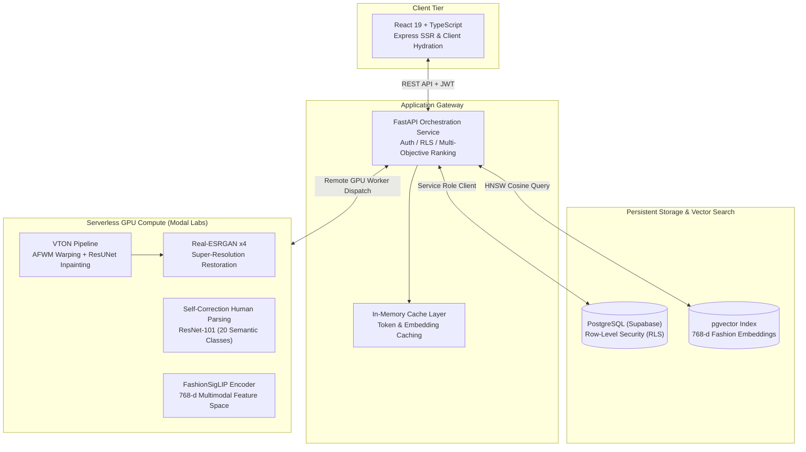

<div align="center">

# WEAVE

### Neural Virtual Try-On & Multimodal Fashion Intelligence System

[](https://weave-curator.vercel.app/)
[](https://python.org)
[](https://pytorch.org/)
[](https://fastapi.tiangolo.com/)
[](https://react.dev/)
[](https://github.com/pgvector/pgvector)

</div>

https://github.com/user-attachments/assets/cb3d4c37-54ef-43f0-a8c3-2e3ed4457b56

<div align="center">

<p align="center">
  <b>An end-to-end AI fashion platform unifying generative garment synthesis, CIELAB color science, and 768-dimensional multimodal retrieval into a production microservice architecture.</b>
</p>

</div>

---

## The Problem & Motivation

Traditional e-commerce fashion experiences suffer from two critical disconnects:
1. **The Representation Gap**: Static flat-lay or model-photographed images fail to communicate how silhouettes, fabrics, and collar geometry interact with an individual’s unique body shape and pose.
2. **The Aesthetic Disconnect**: Conventional recommendation engines rely exclusively on generic text tags or category trees, ignoring objective color science (how garment palettes interact with individual skin undertones) and semantic style subtleties.

**Weave** addresses this with a hybrid generative platform: combining pose-adaptive geometric neural garment warping, human semantic parsing in CIELAB perceptual color space, and dynamic multi-criteria ranking.

---

## System Architecture

Weave is designed as a decoupled, latency-optimized microservices pipeline that separates stateless API orchestration from serverless cloud GPU clusters:



---

## Technical Highlights

### 1. High-Fidelity Generative Virtual Try-On
The virtual try-on engine synthesizes photorealistic draped garments on user-submitted photos through a three-stage neural pipeline:
* **Pose & Semantic Parsing**: Uses MediaPipe and Self-Correction Human Parsing (SCHP) to isolate clothing regions while preserving face, hair, and limb segmentations.
* **Adaptive Feature Warping Module (AFWM)**: Dynamically estimates non-rigid optical flow and deformation grids, warping the 2D garment to map seamlessly onto target torso curves, posture, and arm positions without 3D mesh scanning.
* **Inpainting & Synthesis (ResUNet)**: A ResUNet generator synthesizes natural creases, lighting highlights, sleeve boundaries, and shadow gradients.
* **Super-Resolution Upscaling (Real-ESRGAN)**: Enhances the synthesized output through Real-ESRGAN $\times$4 restoration, recovering high-frequency textile textures and fabric weaves before delivery.

```
Garment Image ──► [AFWM Warping] ──┐
                                   ▼
User Photo    ──► [Human Parsing] ─► [ResUNet Inpainter] ──► [Real-ESRGAN] ──► Final Try-On
```

---

### 2. Tri-Modal Adaptive Recommendation Algorithm
Rather than static rule-based ranking, Weave implements an adaptive multi-objective scoring function:

$$\text{Score}(u, g) = w_1 \cdot S_{\text{color}}(u, g) + w_2 \cdot S_{\text{semantic}}(u, g) + w_3 \cdot S_{\text{collab}}(u, g)$$

Where user taste weights $(w_1, w_2, w_3)$ dynamically self-balance based on historical interactions:

#### A. Color Science ($S_{\text{color}}$)
* Extracts the user's skin and hair pigments into **CIELAB color space** (which models human visual perception where Euclidean distance correlates directly to perceived color difference).
* Computes color harmony scores by calculating $\Delta E^*$ distances between the user's personal color palette and the garment’s extracted dominant hex pigments.

#### B. Semantic Vector Similarity ($S_{\text{semantic}}$)
* Garments and textual natural language queries are projected into a unified 768-dimensional space using **`Marqo/marqo-fashionSigLIP`**.
* Queries execute directly inside PostgreSQL using **`pgvector`** with Cosine Distance indexing, allowing natural language search (e.g., *"relaxed oversized earthy linen jacket for spring evening"*).

#### C. Implicit Collaborative Filtering ($S_{\text{collab}}$)
* Dynamically updates user preference vectors based on explicit actions (try-ons, bookmarking, dismissals) to refine catalog sorting in real-time.

---

### 3. Production Engineering & System Design

* **Serverless GPU Orchestration**: Model execution is isolated to remote on-demand GPU containers on Modal. The web API remains lightweight (<130 MB memory footprint), avoiding GPU idle costs while scaling to concurrent traffic.
* **Dual-Mode Rendering**: Built with React 19 Server-Side Rendering (SSR) through Express for instant first-contentful paint (FCP), paired with a zero-config static SPA fallback.
* **Database Row-Level Security (RLS)**: PostgreSQL enforces security policies at the database layer. Client tokens are validated against Supabase Auth, preventing unauthorized queries or data exfiltration.

---

## Tech Stack

| Domain | Technologies |
| :--- | :--- |
| **Deep Learning & CV** | PyTorch, torchvision, Real-ESRGAN, MediaPipe, SCHP (ResNet-101), FashionSigLIP, CuPy |
| **Backend & API** | FastAPI, Python 3.12, Uvicorn, Pydantic, HTTPX, NumPy, OpenCV Headless |
| **Cloud GPU Infrastructure** | Modal Labs (Serverless NVIDIA T4 / A10G clusters) |
| **Database & Vector Search** | PostgreSQL, pgvector (768-d embeddings), Supabase (Auth & Database RLS) |
| **Frontend & UI** | React 19, TypeScript, Vite, Tailwind CSS, Express (SSR), SWR |

---

## Quickstart (Local Development)

### Prerequisites
* Python 3.12+
* Node.js v22+
* Modal CLI (`pip install modal && modal setup`)

### 1. Clone & Setup Backend
```bash
git clone https://github.com/ScriptedLines/Weave.ai.git
cd Weave.ai

python3 -m venv .venv
source .venv/bin/activate
pip install -r requirements.txt

# Start backend server
uvicorn backend:app --host 127.0.0.1 --port 8000 --reload
```

### 2. Setup Frontend
```bash
cd frontend
npm ci
npm run dev
```

### 3. Deploy Remote GPU Container
```bash
modal deploy vton/vton_model.py
```

---

## Key Achievements & Benchmarks

* **Sub-Second Semantic Retrieval**: ~25ms vector similarity query latency over thousands of catalog items via indexed `pgvector` embeddings.
* **High-Precision Warping**: Robust garment-to-body alignment across diverse poses, preventing edge distortion through adaptive optical flow estimation.
* **Cost-Optimized Architecture**: 100% serverless GPU execution model—$0 idle compute overhead, scaling on-demand.

---


