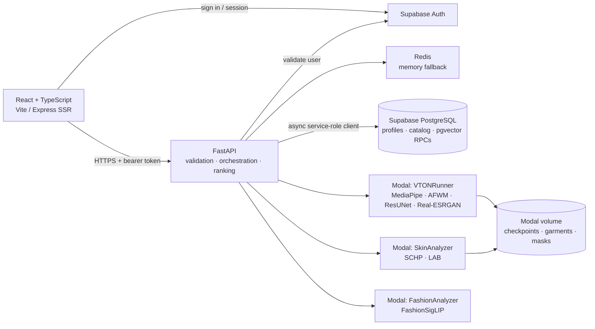

<div align="center">

# WEAVE

**Virtual try-on and personalized fashion discovery**

[Live application](https://weave-curator.vercel.app/) · [System architecture](#system-architecture) · [How it works](#end-to-end-user-flow) · [Local setup](#local-development)

</div>

Weave is a full-stack fashion application that combines a virtual try-on pipeline with color-aware recommendations and semantic clothing search. A React frontend communicates with a FastAPI service; Supabase provides authentication and data storage, Redis caches expensive work, and Modal runs the GPU models.

This repository is a portfolio project demonstrating application design across frontend, API, database, and machine-learning inference. The descriptions below distinguish the implementation from deployment-specific dependencies and avoid claiming unverified performance or model quality.

## Features

- **Virtual try-on:** upload a photo, choose a catalog garment, generate a JPEG result, and download it. The model currently uses garment images and masks already stored in a Modal volume.
- **Color profile:** estimate skin and hair colors from a photo and use them as signals in clothing recommendations.
- **Personalized discovery:** rank garments using color suitability, similarity to the user's clothing preferences, and collaborative signals from similar users.
- **Semantic search and filters:** describe a garment by color, category, neckline, sleeve, occasion, and additional text; encode the description and search the catalog by vector similarity.
- **Preference feedback:** like or dislike garments; update the user embedding and invalidate cached recommendations.
- **Accounts and access:** Supabase email/password authentication, email verification, profile creation, and an approval gate for protected features.
- **Responsive application shell:** separate site/documentation and Studio navigation, expandable desktop sidebar, mobile navigation, left-side filters, and an account menu.
- **Operational safeguards:** input limits, rate limiting, health/readiness checks, async database access, bounded caching, and graceful degradation for some recommendation dependencies.

## System architecture



| Layer | Responsibility | Architectural choice |
| --- | --- | --- |
| React / TypeScript | Account flows, Studio, catalog, filters, and documentation | A shared layout keeps navigation consistent; client-side routing allows the Studio and public documentation to have separate navigation. |
| Express / Vite | Server-render initial HTML, hydrate in the browser, and serve assets | SSR and a static SPA build are both available. Authenticated content still depends on the client session and API calls. |
| FastAPI | Authenticate requests, enforce approval, validate inputs, coordinate services, and rank recommendations | Async Supabase and Modal calls keep the API responsive while waiting on external services. Model execution is kept outside the web process. |
| Supabase | Authentication, profile and catalog storage, and vector-search functions | PostgreSQL stores user preferences and precomputed garment features near the data queried by the API. |
| Redis / memory | Cache results, counters, and recommendation generations | Redis shares cached state between workers; bounded in-process memory provides a fallback when Redis is unavailable. |
| Modal | Host the try-on, human parsing, and text-embedding models | GPU inference runs independently of the CPU API. Models load when a worker starts and can be reused for subsequent calls. |

The API uses a **service-role** Supabase client, so authorization is enforced in the API by validating the user's bearer token and checking approval. The service-role key must remain server-side. The included approval migration revokes direct profile-table access from the `anon` and `authenticated` roles; deployed database policies should be reviewed alongside the migration.

## End-to-end user flow

### 1. Authentication and access

1. The frontend signs in or signs up through Supabase Auth and attaches the session's bearer token to API requests.
2. FastAPI validates the token using Supabase Auth. Successful claims are cached briefly under a hash of the token.
3. `POST /profile/ensure` finds or creates the corresponding profile. New profiles default to pending approval.
4. The frontend routes pending users to the approval screen. Protected endpoints check `profiles.is_approved` before serving Studio features.
5. Once approved, a user can create a color profile, browse clothing, provide feedback, and use virtual try-on.

The account menu links to a profile page showing the stored username, email, and approval status. The separate color-profile page handles photo analysis.

### 2. Color profile

```text
Photo → API upload validation → Modal SkinAnalyzer → skin/hair LAB → profiles
```

`SkinAnalyzer` uses a 20-class SCHP ResNet-101 human-parsing model. It selects skin and hair regions, erodes the masks to reduce boundary contamination, converts the image to OpenCV LAB, and takes the median color of each region. The service has fallback values when a region contains no pixels. The API stores the two LAB arrays without overwriting unrelated account details and changes the recommendation cache generation.

**Why this approach:** semantic masks make the estimate less dependent on clothing and background pixels; median aggregation is less sensitive to isolated outliers than a simple mean. The estimate remains dependent on lighting, image quality, segmentation, and model limitations; it is not a measurement of a person's identity or an objective judgment of style.

### 3. Catalog, preferences, and recommendations

Garments in `fashion_items` have catalog fields and precomputed features such as `lab_value` and `vector_features`. `recommendation/database_update.py` contains an offline catalog enrichment workflow that uses FashionSigLIP and color extraction to populate features; runtime search does not generate every catalog embedding on demand.

When a user likes or dislikes items, the frontend saves both lists through `POST /profile/preferences` and requests `POST /sync_embedding`. The sync fetches item vectors in chunks, computes the mean liked vector minus half the mean disliked vector, and L2-normalizes the result. Empty interactions clear the stored embedding. Dirty/synced versions avoid unnecessary work; an in-process per-user lock reduces duplicate syncs.

For `GET /recommend`, the API fetches the profile, color inventory, content matches, and similar-user matches concurrently. It then combines three normalized signals:

```text
score = w_color × color_score + w_content × content_score + w_collab × collaborative_score

w_content = min(0.40, 0.04 × number_of_interacted_items)
w_collab  = min(0.40, 0.08 × number_of_similar_users)
w_color   = 1 − w_content − w_collab
```

- **Color:** a heuristic in `recommendation/skin_recom.py` scores undertone alignment, hue-vector similarity, lightness contrast, chroma, and washout penalty. The inventory calculation is vectorized with NumPy. This is a heuristic, not a learned stylist or a ΔE-only metric.
- **Content:** the `match_clothes_by_user` database RPC compares the stored user embedding with garment vectors. Similarities are normalized from `[-1, 1]` to `[0, 1]` for ranking.
- **Collaborative:** the `get_similar_users` RPC returns users and their liked garments. The backend uses their similarities as a collaborative signal and suppresses that signal for garments the current user has already interacted with.

With limited interaction history, the color signal has more weight. If profile or similarity calls fail, the endpoint can return a `degraded` feed using available signals; an inventory failure returns an error. Degraded feeds have a shorter cache lifetime.

### 4. Semantic search

`POST /text_search` turns the submitted filter fields into a descriptive product-photo prompt. The Modal `FashionAnalyzer` tokenizes it and generates a normalized text embedding using `Marqo/marqo-fashionSigLIP`. The API calls the `match_clothes_by_text` RPC and returns garment IDs with similarity scores. If gender filtering is requested, it fetches a bounded candidate window and filters IDs against the catalog before applying the requested limit.

**Why FashionSigLIP and pgvector:** catalog image vectors and text queries can be compared in the same feature space, while similarity queries run close to the stored catalog. The deployed schema and indexes determine actual performance; no specific latency or index type is guaranteed by this repository.

### 5. Virtual try-on

```text
User photo ──→ MediaPipe person segmentation / crop ─────────────┐
                                                                ├─→ AFWM warp → ResUNet composite → Real-ESRGAN → JPEG
Catalog ID ──→ garment name ──→ Modal volume image + mask ──────┘
```

1. The API validates the image's content type, byte size, dimensions, and pixel count, and resolves the catalog ID to a garment name.
2. `VTONRunner` loads the person segmentation model, AFWM warp model, ResUNet generator, and Real-ESRGAN upscaler when its Modal container starts. The current configuration requests an A10G GPU.
3. The worker segments and crops the person, resizes inputs to the model's 256 × 192 working size, and loads the matching garment image and mask from the Modal volume.
4. AFWM predicts a flow field used to warp the garment and its mask. The pipeline processes the warped mask against the person mask and passes the person, warped garment, and mask to the ResUNet generator.
5. The generator produces rendered pixels and a composition mask; the pipeline blends these with the warped garment. Real-ESRGAN enhances the output, which is encoded as JPEG.
6. The API verifies that the result is a JPEG before caching and returning it.

**Why split warping and generation:** warping explicitly aligns the selected garment, while the generator produces the composite around it. The upscaler improves output resolution, but it cannot guarantee accurate fit, fabric behavior, or photorealism. Generated illustrations in the website are examples, not model output.

### Model architecture details

| Component | Implementation in this project | Why it is used |
| --- | --- | --- |
| MediaPipe segmentation | A multiclass selfie segmentation model provides masks used to isolate and crop the person before try-on. | Separates the person from the background and supplies a mask for composition. |
| AFWM | Separate person-conditioning and garment feature encoders feed refined feature pyramids. `AFlowNet` uses feature correlation and successive flow refinements across scales; the final flow samples the garment and its mask. | A multiscale flow field can align garment features to the input image without requiring a 3D body mesh. |
| ResUNet generator | A residual U-Net with skip connections takes seven channels: the person image, warped garment, and warped mask. It emits three rendered image channels and one composition-mask channel. | Skip connections carry spatial information across the network; the learned mask blends generated pixels with the warped garment. |
| Real-ESRGAN | The worker loads the `RealESRGAN_x4plus` checkpoint and runs its enhancement step on the composite. | Restores output resolution after the low-resolution try-on stage. Added detail is synthesized and should not be treated as ground truth. |
| SCHP | A 20-class ResNet-101 human parser produces segmentation logits that are mapped back to the original photo size. | Isolates skin and hair regions for color analysis, separate from the try-on segmentation model. |
| FashionSigLIP | `open_clip` loads `Marqo/marqo-fashionSigLIP`; the worker encodes and normalizes text embeddings, while the offline catalog workflow encodes garment images. | Enables text-to-image similarity in a shared vector space for search and content-based ranking. |

The repository contains model and inference implementations, but not a complete, reproducible training dataset and training run for these checkpoints. The architecture description above is based on the checked-in inference path rather than a claim that every model was trained from scratch in this repository.

## Performance and reliability decisions

- **Async I/O and concurrency:** a lazily initialized async Supabase client and concurrent independent recommendation queries reduce time spent waiting. A process-level semaphore bounds database request concurrency; color ranking runs in a worker thread.
- **Pagination:** catalog inventory and RPC results are read in pages. An exact count is requested on the first page where available; text search also limits the candidate window. Correct and complete results still depend on deployed PostgREST limits and stable RPC ordering.
- **Singleflight:** identical in-flight text embeddings, inventory fetches, recommendations, warmups, and try-on requests share one task within an API process. A cancelled waiter does not cancel the shared task; failed tasks can be retried.
- **Caching:** individual catalog records, inventory, successful auth/approval checks, embeddings, skin analysis, recommendations, and valid try-on output use TTLs appropriate to their role. The memory fallback has byte and entry limits and evicts least-recently-used entries.
- **Recommendation invalidation:** preference, skin-profile, and embedding updates change a per-user generation included in feed cache keys. Older work may finish for its original caller, but its cached result is not used by the new generation.
- **Redis recovery:** failed operations fall back to memory with a reconnect delay. Atomic Redis increment-and-expiry counters support rate limits. A healthy Redis miss does not resurrect an old in-memory value.
- **Graceful failure:** failed warmup dispatches are not marked successful, malformed try-on images are rejected, and a degraded recommendation feed is cached for 30 seconds rather than the normal 10 minutes.
- **Smaller API image:** the Dockerfile uses Python 3.12 slim, runs as a non-root user, and excludes model datasets and vendored model code from the API image. GPU dependencies live in the Modal image.

These mechanisms have boundaries: singleflight and embedding locks are process-local. Memory fallback cannot synchronize rate limits or cache generations between workers, and invalidation during a Redis outage cannot guarantee cross-worker consistency. Token and approval caches also introduce short delays before external changes are observed.

## API overview

| Endpoint | Purpose |
| --- | --- |
| `GET /health` · `GET /ready` | Liveness and dependency readiness |
| `POST /profile/ensure` · `GET /profile` | Create or read the authenticated user's profile |
| `GET /username_available` | Check a proposed username |
| `POST /profile/preferences` · `POST /sync_embedding` | Save likes/dislikes and synchronize the user vector |
| `GET /items` · `GET /items/{id}` | Retrieve public catalog fields |
| `POST /skin_color` | Analyze skin and hair colors and update the profile |
| `GET /recommend` | Return ranked item IDs, weights, and degradation status |
| `POST /text_search` | Return semantic matches for filter criteria |
| `POST /tryon` | Return a JPEG for a photo and catalog garment ID |
| `POST /warmup` | Dispatch model warmup requests; dispatch success does not prove inference is ready |

The running API exposes its generated schema at `/docs`. Most Studio endpoints require an approved user; `/profile` and `/profile/ensure` require authentication but are available before approval.

## Tech stack

| Area | Technologies |
| --- | --- |
| Frontend | React 19, TypeScript, React Router, Vite, Express SSR, Tailwind CSS |
| API | Python 3.12, FastAPI, async Supabase client, NumPy, OpenCV, Pillow |
| Data | Supabase Auth, PostgreSQL, pgvector, Redis |
| Inference | Modal, PyTorch, MediaPipe, AFWM, ResUNet, Real-ESRGAN, SCHP, FashionSigLIP |
| Deployment | Vercel frontend configuration, Docker API image, Modal GPU workers |

## Local development

### Prerequisites

- Python 3.12 and Node.js 22.
- A Supabase project with the catalog, profiles, pgvector data, and required RPCs described below.
- Access to the deployed Modal app and its model volume for color analysis, search embeddings, and try-on.
- Redis is optional for a single local API process.

### Backend

```bash
python3 -m venv .venv
source .venv/bin/activate
pip install -r requirements.txt
```

Create a root `.env` file:

```dotenv
SUPABASE_URL=https://YOUR_PROJECT.supabase.co
SUPABASE_SERVICE_ROLE_KEY=YOUR_SERVER_SIDE_SERVICE_ROLE_KEY
# Optional: omit to use process-local memory caching
REDIS_URL=redis://localhost:6379
```

Keep the service-role key private. For local Modal access, authenticate the Modal CLI using your own credentials. The backend needs access to the deployed `vton-service` app; in hosted environments the Modal client can use `MODAL_TOKEN_ID` and `MODAL_TOKEN_SECRET` as server-side secrets.

```bash
uvicorn backend:app --host 127.0.0.1 --port 8000 --reload
```

Check `http://127.0.0.1:8000/health`, `http://127.0.0.1:8000/ready`, and `http://127.0.0.1:8000/docs`. Readiness checks the configured database and Redis; it does not run GPU inference.

### Frontend

Create `frontend/.env.local`:

```dotenv
VITE_SUPABASE_URL=https://YOUR_PROJECT.supabase.co
VITE_SUPABASE_ANON_KEY=YOUR_PUBLIC_ANON_KEY
# Vite can also proxy /api to localhost:8000 if this is omitted
VITE_API_BASE_URL=http://localhost:8000
```

```bash
cd frontend
npm ci
npm run dev:client
```

Open the local URL printed by Vite, normally `http://localhost:5173`. `npm run dev` starts the Express SSR development server instead. `npm run build` builds both client and SSR output; `npm run build:static` builds the static SPA variant.

### Database and model prerequisites

The API expects `profiles` and `fashion_items`, including LAB and vector columns, plus these deployed RPCs:

- `match_clothes_by_text(query_embedding, match_threshold)`
- `match_clothes_by_user(target_user_id)`
- `get_similar_users(target_user_id)`

The repository includes an approval migration at `supabase/migrations/20261104000000_add_profile_approval.sql`, **not** the complete database schema or the three RPC definitions. Existing deployments must supply these separately. The live `match_clothes_by_user` function was corrected to return a `bigint` ID matching `fashion_items.id`; that deployment change is not versioned here. Review migration effects and database permissions before applying it to an existing project.

The Modal app is defined in `vton/vton_model.py` and uses the `vton-checkpoints` volume. It expects the referenced model checkpoints as well as matching `/vol/cloth/<name>.jpg` and `/vol/cloth_mask/<name>.jpg` files. Model checkpoints, garment datasets, and some vendored model directories are excluded from Git. A fresh checkout alone is therefore insufficient to redeploy the GPU service; restore those assets first. Once configured, deployment uses:

```bash
modal deploy vton/vton_model.py
```

### Configuration and deployment

Application limits and cache defaults live in `backend_settings.py`. Optional backend environment settings include `REDIS_URL`, `MODAL_APP_NAME`, `ALLOWED_ORIGINS`, `ALLOWED_ORIGIN_REGEX`, `LOG_LEVEL`, and the server's `PORT`. The default CORS origins include the project's production Vercel URL and local Vite development origins; configure the actual production origin when deploying elsewhere.

The repository provides an API `Dockerfile` and a local Redis/API `docker-compose.yml`. The frontend has Vercel SSR and static configurations; set the Vercel project root to `frontend` and provide the `VITE_*` values there. The frontend's Supabase key is public; never put the service-role key or Modal credentials in a `VITE_*` variable. Configure Supabase Auth redirect URLs for the deployed `/verify-waiting` route.

## Verification and known limitations

- Frontend production client and SSR builds have passed locally. The API optimization regression suite was run locally; local test files are ignored by Git and may not be present in a fresh checkout.
- Live checks during development exercised catalog reads, Redis counters, Modal model inference, text search, and the corrected `match_clothes_by_user` RPC. A sampled `get_similar_users` call returned no rows, so nonempty collaborative results were not verified in that check.
- A complete authenticated user journey and Docker image build/runtime were not verified in the recorded environment. Docker daemon access was unavailable.
- Results can show visual artifacts. Model latency, recommendation quality, fairness, privacy guarantees, and production scale have not been established by a representative benchmark.
- Custom garment uploads are not supported by the deployed try-on interface; garment images and masks must already exist in the Modal volume.
- Redis outage fallback is per process, and successful warmup dispatch does not guarantee a worker is ready. Full deployment reproducibility requires versioning the database schema/RPCs and provisioning the model assets.

## Repository map

```text
backend.py                       FastAPI endpoints, caching, ranking, orchestration
backend_settings.py              API limits and cache defaults
recommendation/skin_recom.py     Vectorized LAB-based suitability scoring
recommendation/database_update.py  Offline catalog feature enrichment
vton/vton_model.py               Modal model classes and image setup
vton/pipelines/                  Try-on inference and composition pipeline
vton/models/                     Warp and generator implementations
frontend/src/                    React pages, layouts, auth, and API client
frontend/server.js               Express SSR / SPA fallback
supabase/migrations/             Profile approval migration
Dockerfile                       CPU API image
```
